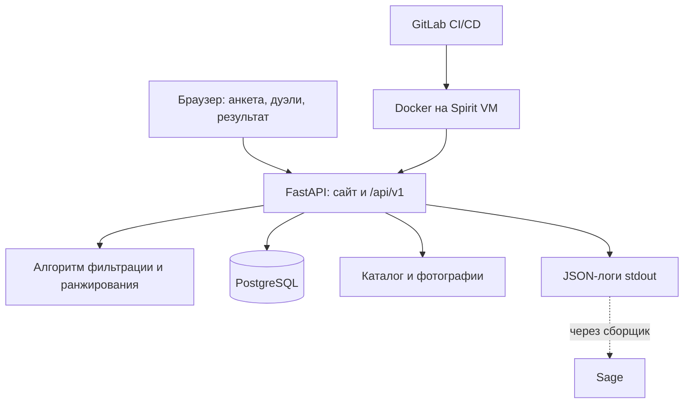

# Архитектура AutoChoice

## Компоненты

- web/ — HTML, CSS, JavaScript и изображения;
- app/main.py — сервер FastAPI, Swagger, маршруты и API;
- app/ — правила подбора и работа с данными;
- data/ — каталог 30 автомобилей и кадры слепых дуэлей;
- PostgreSQL — хранилище данных;
- Docker — развёртывание на Spirit VM;
- GitLab CI/CD — тестирование, сборка образа, деплой;
- app/observability.py — журналирование запросов в JSON.

GitHub Pages работает лишь со статическими файлами, поэтому он ведёт на запущенный на VM сайт с Python API.